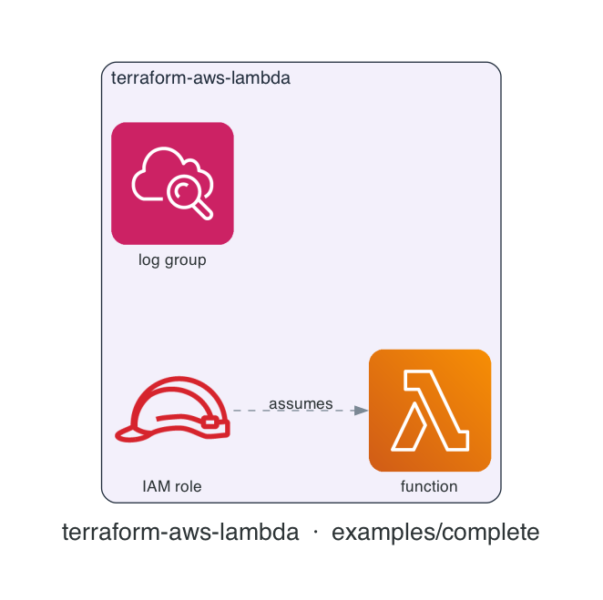

# terraform-aws-lambda

[](https://github.com/devotica-labs/terraform-aws-lambda/actions/workflows/ci.yml)
[](https://github.com/devotica-labs/terraform-aws-lambda/actions/workflows/release.yml)
[](LICENSE)

> Part of the **Devotica** Terraform catalog. Follows the cloudposse module standard (README.yaml-driven docs, the `enabled`/`namespace`/`environment`/`stage`/`name`/`attributes`/`tags`/`label_order` label surface, `examples/complete`, Makefile targets) implemented **natively** — no external naming or build-harness dependencies.

## Introduction

Terraform module for an **AWS Lambda function** with its execution role, an encrypted and retained CloudWatch log group, and optional VPC attachment. It ships fintech-safe defaults so a function is observable, traceable, and least-privilege out of the box.

Defaults are opinionated: **Active X-Ray tracing**, a **pre-created log group** with **30-day retention** (so logs never default to never-expiring) that can be **KMS-encrypted**, an execution role that starts with only **basic log-writing permissions**, and **VPC-access permissions added automatically** when the function is attached to a VPC.

The deployment artifact is either a local zip (`filename`) or an S3 object (`s3_bucket` + `s3_key`) — exactly one. The examples build a tiny artifact inline with `hashicorp/archive`, so the module itself stays free of a build-tool dependency.

## Architecture

<!-- BEGIN_ARCH -->



<sub>Generated by `.github/workflows/architecture-diagram.yml` on every push to main. Do not edit the image by hand — change the Terraform code in `examples/complete/` and the bot will regenerate it.</sub>

<!-- END_ARCH -->

## Usage

```hcl
module "lambda" {
  source  = "devotica-labs/lambda/aws"
  version = "~> 0.1"

  namespace = "dvtca"
  stage     = "prod"
  name      = "api"          # function → dvtca-prod-api

  runtime          = "python3.12"
  handler          = "index.handler"
  filename         = data.archive_file.lambda.output_path
  source_code_hash = data.archive_file.lambda.output_base64sha256

  # Fintech defaults cover tracing, log retention, and the execution role.
  tags = local.tags
}
```

A VPC-attached function with encrypted env vars, a customer-managed key, and an extra policy:

```hcl
module "lambda" {
  source  = "devotica-labs/lambda/aws"
  version = "~> 0.1"

  namespace = "dvtca"
  stage     = "prod"
  name      = "payments"

  runtime          = "python3.12"
  handler          = "index.handler"
  filename         = data.archive_file.lambda.output_path
  source_code_hash = data.archive_file.lambda.output_base64sha256

  kms_key_arn = module.kms.key_arn
  environment_variables = {
    LOG_LEVEL = "INFO"
  }

  vpc_config = {
    subnet_ids         = module.vpc.private_subnet_ids
    security_group_ids = [module.lambda_sg.id]
  }

  additional_policy_arns = ["arn:aws:iam::aws:policy/AmazonDynamoDBReadOnlyAccess"]
}
```

See [`examples/basic`](examples/basic) and [`examples/complete`](examples/complete).

## Defaults that matter

| Setting | Default | Why |
|---------|---------|-----|
| `tracing_mode` | `Active` | Every request is X-Ray traced for latency/error visibility. |
| `log_retention_days` | `30` | The log group is pre-created with bounded retention instead of Lambda auto-creating a never-expiring one. |
| log group encryption | `kms_key_arn` when set | Logs and environment variables are encrypted with the supplied CMK. |
| execution role | basic only | Starts with `AWSLambdaBasicExecutionRole`; extend via `additional_policy_arns`. |
| VPC access policy | auto | `AWSLambdaVPCAccessExecutionRole` attaches only when `vpc_config` is set. |
| `memory_size` / `timeout` | `128` MB / `30` s | Conservative sizing; raise per workload. |
| `reserved_concurrent_executions` | `-1` | Unreserved by default; cap it to protect the account-wide pool. |

## How this fits the Devotica catalog

`terraform-aws-vpc` provides the subnets and `terraform-aws-security-group` the security groups passed into `vpc_config`. `terraform-aws-kms` supplies `kms_key_arn` for log/env encryption. Grant the function access to other resources by passing their IAM policy ARNs into `additional_policy_arns` (e.g. a `terraform-aws-dynamodb` table policy or a `terraform-aws-secretsmanager` read policy).

## Makefile Targets

```
make fmt       # terraform fmt -recursive
make validate  # terraform init -backend=false && terraform validate
make test      # terraform test (unit + contract; integration needs AWS creds)
make readme    # regenerate the terraform-docs block below
```

<!-- BEGIN_TF_DOCS -->
<!-- terraform-docs regenerates this block via `make readme` / CI. Inputs and
     outputs are documented in variables.tf and outputs.tf. -->
<!-- END_TF_DOCS -->

## License

[Apache 2.0](LICENSE) © Devotica
